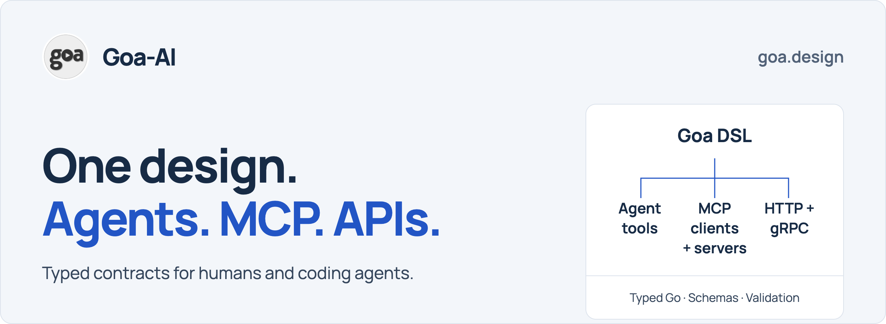
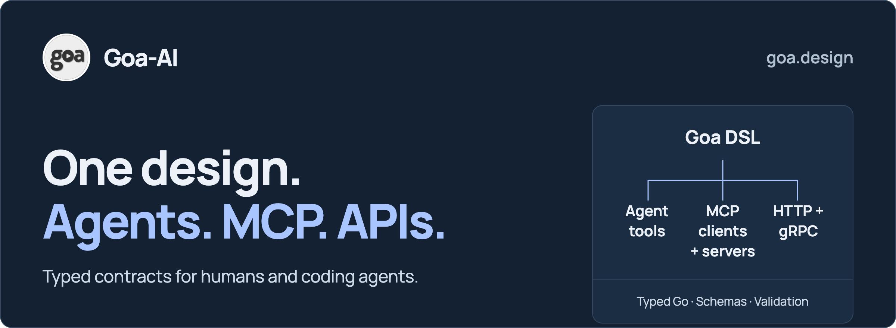

<p align="center">
  <a href="https://goa.design/docs/2-goa-ai/#gh-light-mode-only">
    <picture>
      <source media="(max-width: 600px)" srcset="docs/img/goa-ai-banner-mobile.png">
      
    </picture>
  </a>
  <a href="https://goa.design/docs/2-goa-ai/#gh-dark-mode-only">
    <picture>
      <source media="(max-width: 600px)" srcset="docs/img/goa-ai-banner-mobile-dark.png">
      
    </picture>
  </a>
</p>

<p align="center">
  <a href="https://github.com/goadesign/goa-ai/releases/latest"></a>
  <a href="https://github.com/goadesign/goa-ai/actions/workflows/ci.yml"></a>
  <a href="https://pkg.go.dev/goa.design/goa-ai"></a>
  <a href="LICENSE"></a>
</p>

# Goa-AI: agents, MCP, and tool registries in Go

**Design your capabilities once. Generate the contracts that connect your services, AI agents, and MCP clients.**

Goa-AI extends [Goa](https://goa.design) with AI agents, the Model Context Protocol
(MCP), and distributed tool registries. Write a design in Go; generate typed
clients, servers, model schemas, validation, and runtime wiring. Implement your
application's behavior in ordinary Go.

For engineers, this means fewer contracts to maintain and compiler feedback when
they change. For coding agents, it means explicit types, generated validation,
and an application-specific guide to the code they need to implement.

**[Run the quickstart](#quick-start)** · **[Explore the guides](https://goa.design/docs/2-goa-ai/)** · **[Upgrade to v0.89.0](docs/releases/v0.89.0.md#required-upgrade-actions)**

## Choose what you want to build

| Your goal | Start here |
| --- | --- |
| **An AI agent** that calls typed tools, returns structured answers, and can pause for human input | [Agent quickstart](quickstart/README.md) |
| **An MCP server** exposing Go service methods, resources, and prompts, or **an MCP client** consuming them | [MCP integration guide](https://goa.design/docs/2-goa-ai/mcp-integration/) |
| **A tool registry** that publishes capabilities across services and lets agents discover independently implemented Agent operations without loading provider code, or binds generated native tools to selected registrations while retaining typed codecs and child routes | [Registries and tool search](docs/tool_search.md) |

Low-level runtime and custom Store integrations use a required generated
[run subject](docs/run-subjects.md) to identify the actual executor. Read its
upgrade requirements before changing a deployment with saved runs.

These capabilities compose. You can also use MCP servers and clients independently
of the agent runtime.

Paged agent tools declared with `ContinueWith` publish one operation for both
the initial query and subsequent pages. Direct callers supply the declared page
arguments; agents receive temporary no-argument actions tied to the exact query.
See [pagination ownership](DESIGN.md#pagination-ownership) for the generated
input and execution contracts.

## One design, several ways to use it

A product lookup can be an HTTP endpoint, a gRPC method, an MCP tool, and a local
agent tool. The input, output, descriptions, and validation come from the same
design:

```go
package design

import (
    . "goa.design/goa/v3/dsl"
    . "goa.design/goa-ai/dsl"
)

var Lookup = Type("Lookup", func() {
    Field(1, "sku", String, "Product SKU", func() { MinLength(1) })
    Required("sku")
    Example(map[string]any{"sku": "SKU-123"})
})

var Product = Type("Product", func() {
    Field(1, "name", String, "Product name")
    Required("name")
})

var _ = Service("catalog", func() {
    Description("Look up products for applications and shopping assistants.")
    MCP("catalog", "1.0.0")
    JSONRPC(func() { POST("/mcp") })

    Method("lookup", func() {
        Description("Retrieve a product by its SKU.")
        Payload(Lookup)
        Result(Product)
        HTTP(func() { GET("/products/{sku}") })
        GRPC(func() {})
        Tool("lookup", "Look up a product by SKU")
    })

    Agent("shopper", "Help customers find products", func() {
        Use("products", func() {
            Tool("lookup", "Look up a product by SKU", func() {
                BindTo("lookup")
            })
        })
    })
})
```

Run generation using the Goa version selected by your application:

```bash
go run goa.design/goa/v3/cmd/goa gen <design-package-import-path>
```

| From this design | You get |
| --- | --- |
| Service contract | Typed Go interfaces, payloads, results, and validation |
| Agent tool | Model-facing JSON Schema, examples, codecs, and a service executor |
| MCP tool | A typed client and HTTP server with discovery and input/output schemas |
| HTTP and gRPC methods | Clients, servers, OpenAPI, and protobuf definitions |

Change a field and regenerate these contracts together. Your implementation,
planner, authorization, and business rules remain application code. Ordinary
methods can coexist with MCP tools in the same service.

Tools can expose a focused subset of a method's inputs and results, inject
server-owned values, or return a selected Goa result view. The generator handles
the declared transforms. See [service bindings](docs/dsl.md#bindto-service-method-binding)
and [MCP composition](docs/dsl.md#mcp-server-definition).

## Quick start

With **Go 1.27.0 or newer**, run the checked-in example:

```bash
git clone https://github.com/goadesign/goa-ai.git
cd goa-ai/quickstart
go run ./cmd/orchestrator
```

It runs the real agent loop and typed completions with a deterministic planner
and an in-memory engine and store. **No model API key, Temporal, Redis, or MongoDB
is required.** You'll see:

```text
Assistant: Tool helpers.answer returned {"text":"Tokyo is the capital of Japan."}
Completion draft_task: Prepare launch checklist (Confirm the service is ready to launch.), 3 steps
```

Run its evaluation suite:

```bash
go run ./cmd/chat_quality-evals
```

The [quickstart guide](quickstart/README.md) walks through the design, generation,
service wiring, and connecting a model. For MCP, follow the
[MCP integration guide](https://goa.design/docs/2-goa-ai/mcp-integration/).

## What you can build

### Agents and typed outputs

- **Typed tools and structured answers.** Bind tools to Goa methods or custom
  executors; declare `Completion(...)` for typed direct responses. Generated
  codecs and schemas enforce the authored contract.
- **Correction of invalid tool calls.** Missing fields, wrong types, and invalid
  values receive specific feedback and authored examples. The runtime can ask
  the model for a replacement within your recovery budget, before execution.
- **Specialist agents.** Expose agents as tools and compose real child runs with
  linked progress and cancellation. Cancellation preserves completed results
  and waits for required cleanup before closing the run; cleanup failures remain errors.
  Child workflow IDs stay bounded for long names and repeated nesting; see the
  [identifier and worker upgrade contract](docs/runtime.md#child-run-identifiers-and-worker-upgrades).
- **Human input and approvals.** Save a pending question or confirmation and
  continue from the host's answer. Direct and registered operations share durable
  continuation submission and completion. Hosts supply each successor workflow's
  Memo explicitly; recovery preserves it and rejects changed answers or metadata.
  Canceling a root question with no saved child or remote work closes its
  continuation while preserving the original
  suspended result. Text-only runs exclude interactive tools. Hosts can apply the
  same restriction to exact direct and registered operations with `WithTextOnly(true)`.
- **Large results and images.** Bound model-visible results, continue paginated
  queries, retain native image evidence, and keep rich host data outside model
  requests. Saved history remains readable after tool changes; only compatible
  current tools can supply another page.

[Agent DSL](docs/dsl.md#agent-use-and-export) · [Runtime and composition](docs/runtime.md) · [Native images](docs/native_images.md)

### MCP clients and servers

- **MCP 2026-07-28 over HTTP.** Generate stateless servers and typed clients with
  discovery, tools, structured results, and ordered text, image, audio, resource
  links, and embedded resources. Consumers also support stdio; generated stdio
  servers are deferred. Generated HTTP servers also accept basic `2025-11-25`
  clients on the same URL, using the same configured Goa endpoints. See the
  [older-client contract](docs/runtime.md#older-http-clients).
- **Runtime-defined tools.** Declare `DynamicTools()` to implement tool listing
  and invocation through generated protocol types without authored static tools.
  Older clients receive dynamic structured results in a matching `value` object;
  modern clients receive the original JSON value.
  See [runtime-defined tools](docs/dsl.md#runtime-defined-tools).
- **Resources and prompts.** Serve fixed or parameterized text/binary resources,
  typed prompts, argument completion, and authenticated paginated catalogs.
- **Progress and subscriptions.** Report progress from ordinary service methods;
  observe catalog changes, resource updates, and full Task state. Silent HTTP
  responses use transport keepalive comments without requiring service progress.
  **Regenerate MCP servers when upgrading:** a dependency-only update leaves
  streaming before middleware. Follow the [required upgrade](docs/runtime.md#request-scoped-mcp-progress).
- **Additional input and durable Tasks.** Collect form input or URL consent;
  preserve additional protocol members without changing declared fields;
  expose existing durable jobs with creation, observation, answers, and
  cancellation. The same native methods work as local and registry tools.
- **Authorization.** Compose browser OAuth, machine credentials, signed client
  authentication, and enterprise identity exchange. Servers verify configured
  signed tokens or use token introspection. Hosts own trusted registration,
  consent, and private credential storage.
- **Apps and Skills.** Associate tools with HTML app resources and caller
  visibility; publish Skill catalogs and files with manifest verification.
  Reference hosts demonstrate browser isolation and content-bound approval.

[MCP declarations](docs/dsl.md#mcp-server-definition) · [Clients and authorization](docs/runtime.md#mcp-callers) · [Apps example](integration_tests/apps/README.md) · [Skills guide](docs/mcp_skills.md)

Context-limit responses are recovered by the workflow rather than accepted as
completed answers or executable tool batches. The runtime uses its existing
history policy to summarize older turns before a replacement request, preserves
live text and usage, and stops if compaction cannot shorten the input. This
uses the existing recovery-turn budget. See
[context-window recovery](docs/runtime.md#context-window-recovery).

Initial-history writes reference the already bound preparation operation; seed
reads return its original invocation without duplicating it in bounded commands.
Custom stores must follow the [preparation ownership upgrade](docs/runtime.md#preparation-ownership-upgrade).

### Registries, search, and production execution

- **Distributed tool registries.** Publish typed toolsets, discover changing
  catalogs, and route calls to providers with exact contracts and renewable leases.
  Providers can bound individual Registry operations independently of accepted-call
  shutdown; omitted options retain existing behavior. See
  [provider lifecycle](docs/runtime.md#registry-routed-provider-execution-service-side).
  Catalogs retain resource ownership; applications authorize discovery and use.
  Local maintenance tools can use `registry.NewCatalogReader` to inspect saved
  registrations without starting workers or writing Redis data; see
  [read-only catalog inspection](docs/runtime.md#read-only-catalog-inspection).
  Registered imports derive distinct names for equal operations from different
  owners and retain original declarations for execution and replay.
  Portable bounded-result codecs accept provider result data; the runtime adds
  counts and truncation before publishing results against the advertised schema.
  Generated Agent declarations also retain each operation's authored timeout
  recovery policy through registry transport; see the
  [regeneration requirements](docs/runtime.md#agent-timeout-recovery).
- **Bind generated tools to selected services.** Keep generated tool names,
  input preparation, codecs, and executors while attaching an exact owner-selected
  registration. Calls and retries retain the original route and token. New pages
  select today's provider after the resource owner verifies prior registrations;
  saved queries and completed results remain unchanged. See
  [static service bindings](docs/tool_search.md#bind-generated-service-tools).
  Binding validates complete generated declarations without expanding the
  consuming Agent's executable tools; separately discovered tools remain available.
- **Standalone service operations.** Execute a registered service tool without
  creating a session; sessionful calls retain their existing session. Direct calls
  validate complete execution arguments, including retained query fields and
  continuation cursors, while excluding provider-injected fields. Protocol 15
  requires coordinated registry, provider, and consumer upgrades; see
  [session metadata and upgrade](docs/runtime.md#session-metadata-and-upgrade).
  Registry startup preserves historical declaration identities without decoding
  old consumer metadata as today's executable contract, allowing saved-result
  recovery before provider replacement. This does not change typed historical
  resolution when removed metadata fields cannot fit the current response.
  `GetToolsetSchemas` returns original descriptive fields and input/output schemas
  for inspection without executable metadata or registration authority.
- **Direct Agent operations.** Start typed operations before tool publication,
  using the same provider preparation and result contract as delegation.
  [Revision-owned providers](docs/runtime.md#revision-owned-operation-contracts)
  load and verify complete exports from the selected immutable configuration.
  Providers can select literal messages or exact completed-run history with
  retained privacy exclusions; see the [resolver upgrade](docs/runtime.md#provider-owned-history).
- **Load tools when needed.** Use deferred tool search for whole toolsets or
  selected compiled tools, through supported OpenAI and Claude integrations.
- **Durable execution.** Retain failures and cancellation even before the first
  Run is stored. Use Temporal and an application-owned durable store to
  retain accepted work, host continuations, remote Task identity, and cancellation
  across worker restarts. New turns preserve saved results completed by a later
  run, including conversations stored as literal history. Failed calls stay in
  the transcript and do not block later turns by restoring old paging state.
  Saved results without bounds remain evidence and supply no next page;
  completed page chains remain readable after their tool inputs change.
  Obsolete unfinished queries offer no page action but do not block new turns;
  current bounded results still require bounds and valid arguments.
  Paged operations retain each query and page branch's declared progress labels
  and result previews under the same public tool name. Regenerate callers after
  upgrading to install the matching templates.
  Steps that combine provider-selected calls with extra planner-created calls
  retain every call and result for the next planner activity, including after
  suspension. Completed tool results, accepted arguments, media, and rendered
  previews remain readable through clarification resumes after their generated
  result type changes or their tool is removed. Pending execution, result
  materialization, confirmations, child runs, and unfinished paging still use current
  generated contracts. Original provider messages and reasoning signatures stay
  unchanged.
  The in-memory engine supports local development.
- **Exact root worker builds.** `WithRootExecutionTarget` selects one worker
  deployment and build for an accepted root request. Prepared starts, retries,
  and completion repair preserve that target; child routing remains generated.
  The Temporal adapter can read the current target before work is accepted.
- **Native Temporal handlers.** Register SDK workflows and activities alongside
  agent handlers, and read the exact workflow and activity queues from successful
  registrations before starting workers.
- **Policies and context.** Control permitted tools, call and recovery budgets,
  timing, history compression, prompt caching, and prompt overrides.
- **Evaluation and observability.** Generate typed evaluation suites; observe
  assistant text, tool progress, child runs, usage, and OpenTelemetry traces.
- **Standalone JSON codecs.** Generate strict encoders and decoders beside
  ordinary Goa types, independently of agent and MCP declarations.

[Registries and search](docs/tool_search.md) · [Production configuration](docs/runtime.md#production-configuration) · [Evaluations](docs/evals.md) · [JSON codecs](docs/json_codecs.md)

## Build with a coding agent

Install the **Goa service designer skill** in your application project
(requires Node.js and npm):

```bash
npx skills add goadesign/goa --skill goa-service-designer
```

Give your coding agent the generated `AGENTS_QUICKSTART.md`. It names **your**
agents, tools, packages, and registration functions. A useful first task:

> Add a product lookup tool backed by the catalog service. Update the Goa design,
> regenerate, implement the service method, and verify valid and invalid calls.
> Use AGENTS_QUICKSTART.md for wiring. Do not edit gen/.

`goa gen` replaces generated contracts. `goa example` creates missing application
scaffolding without overwriting existing files. Your application behavior stays
yours. See the [coding-agent workflow](https://goa.design/docs/ai-development/).

## Take it to production

Choose model adapters for OpenAI, Anthropic, Amazon Bedrock, Google Vertex AI,
or a model gateway. [Provider support](docs/runtime.md#model-clients) varies by
model and API. Optional integrations include MongoDB for memory and prompt
overrides, and Redis/Pulse for streams and registries.

Your application owns planners, service behavior, authorization, side-effect
idempotency, durable storage, and deployment. Configure the Temporal engine
**and** a durable runtime store for restart-safe execution. A trusted host
receives runtime events and decides what to expose to users.

**v0.89.0 is a breaking upgrade.** Regenerate and coordinate servers, clients,
providers, runtime workers, and storage implementations. Older MCP revisions,
registry wire versions, and suspension checkpoints are not interchangeable.
Read the [release and upgrade instructions](docs/releases/v0.89.0.md) before
replacing existing deployments; a source rollback alone cannot undo new stored
work.

## Learn more

- [Guided documentation](https://goa.design/docs/2-goa-ai/) — start with agents, MCP, or registries.
- [Framework overview](docs/overview.md) — how design, generation, runtime, and engines fit together.
- [DSL reference](docs/dsl.md) and [runtime reference](docs/runtime.md) — exact contracts and supported choices.
- [Architecture](DESIGN.md) — ownership and execution flows for contributors.
- [Go package reference](https://pkg.go.dev/goa.design/goa-ai) and [release notes](https://github.com/goadesign/goa-ai/releases).

## Contributing

Issues and PRs are welcome. Include a Goa design, failing test, or clear
reproduction when reporting behavior. See [AGENTS.md](AGENTS.md) for repository
guidelines.

Run `make setup` once after cloning or when `.tool-versions` or `.go-install`
changes. It installs the exact protobuf compiler and Go generators used by CI.
Normal `make` targets verify those versions before building or generating code.

## License

MIT License (C) Raphael Simon and the [Goa community](https://goa.design).
